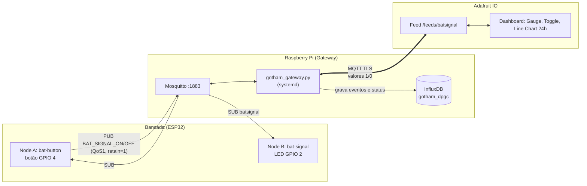

# Central de Inteligência de Gotham (DPGC)

Sistema IoT completo que integra nós de borda (**ESP32**), um gateway local (**Raspberry Pi** com **Mosquitto** e **InfluxDB**) e a nuvem (**Adafruit IO** via MQTT sobre TLS) para acionamento, monitoramento e comando reverso do Bat-Sinal.

> **Segurança:** Credenciais de Wi-Fi, senhas e a chave `AIO_KEY` **não** estão armazenadas neste repositório. No gateway, as variáveis sensíveis devem ser configuradas em um arquivo `.env` local (veja [`gateway/.env.example`](gateway/.env.example)) com permissão restrita (`chmod 600 .env`).

---

## Sumário

1. [Visão Geral e Arquitetura](#1-visão-geral-e-arquitetura)
2. [Estrutura do Repositório](#2-estrutura-do-repositório)
3. [Componentes e Responsabilidades](#3-componentes-e-responsabilidades)
4. [Tópicos MQTT e Payloads](#4-tópicos-mqtt-e-payloads)
5. [Fluxos de Dados](#5-fluxos-de-dados)
6. [Banco de Dados (InfluxDB)](#6-banco-de-dados-influxdb)
7. [Como Configurar e Executar](#7-como-configurar-e-executar)
8. [Operação e Comandos Úteis](#8-operação-e-comandos-úteis)
9. [Pontos de Atenção](#9-pontos-de-atenção)

---

## 1. Visão Geral e Arquitetura



---

## 2. Estrutura do Repositório

```text
iot-dpgc-gotham/
├── bat-button/                  # Firmware ESP-IDF do Node A (Botão / Publicador MQTT)
│   ├── main/
│   │   ├── app_main.c
│   │   ├── mqtt_publisher.c
│   │   └── mqtt_publisher.h
│   └── CMakeLists.txt
├── bat-signal/                  # Firmware ESP-IDF do Node B (Bat-Sinal LED / Assinante MQTT)
│   ├── main/
│   │   ├── app_main.c
│   │   ├── mqtt_subscriber.c
│   │   └── mqtt_subscriber.h
│   └── CMakeLists.txt
├── gateway/                     # Ponte IoT executada no Raspberry Pi
│   ├── gotham_gateway.py        # Script principal (Mosquitto <-> InfluxDB <-> Adafruit IO)
│   ├── gotham-gateway.service   # Unidade systemd para execução contínua
│   └── .env.example             # Exemplo de variáveis de ambiente
├── .gitignore
└── README.md
```

---

## 3. Componentes e Responsabilidades

| Componente | Onde roda | Função |
|---|---|---|
| **Node A (`bat-button`)** | ESP32 | Lê o botão (`GPIO 4`, interrupção na borda de descida) e alterna o estado. Publica o estado em `gotham/dpgc/vinicius/batsignal` com `retain=1`. Envia keep-alive de status a cada 30 s. |
| **Node B (`bat-signal`)** | ESP32 | Assina `gotham/dpgc/vinicius/batsignal` e liga/desliga o LED (`GPIO 2`). Aceita `BAT_SIGNAL_ON/OFF` e `1/0`. Envia keep-alive de status a cada 30 s. |
| **Mosquitto** | Raspberry Pi, porta `1883` | Broker MQTT local. Recebe e distribui as mensagens entre os ESPs e o gateway. |
| **`gotham_gateway.py`** | Raspberry Pi (`gotham-gateway.service`) | Ponte entre o Mosquitto local, o InfluxDB e o Adafruit IO. |
| **InfluxDB 1.x** | Raspberry Pi, porta `8086` | Armazena o histórico de eventos e telemetria com timestamp UTC no banco `gotham_dpgc`. |
| **Adafruit IO** | Nuvem | Feed `batsignal` e dashboard **"Central de Inteligencia DPGC"** (Gauge, Toggle e Line Chart 24h). |

---

## 4. Tópicos MQTT e Payloads

| Onde | Tópico / Feed | Quem publica | Quem consome | Payload |
|---|---|---|---|---|
| Mosquitto local | `gotham/dpgc/vinicius/batsignal` | Node A e o gateway (comando reverso) | Node B, Node A (sincroniza estado) e gateway | `BAT_SIGNAL_ON` / `BAT_SIGNAL_OFF` |
| Mosquitto local | `gotham/dpgc/vinicius/status` | Node A e Node B | gateway (grava no InfluxDB) | JSON `{"device":"bat_button","status":"ONLINE","uptime_s":120}` |
| Adafruit IO | `<AIO_USERNAME>/feeds/batsignal` | gateway e o botão Toggle do dashboard | dashboard e gateway | `1` / `0` |

Os ESPs utilizam texto (`BAT_SIGNAL_ON` / `BAT_SIGNAL_OFF`) e a nuvem utiliza números (`1` / `0`), pois os blocos Gauge e Line Chart do Adafruit IO exigem valores numéricos. O gateway realiza essa tradução nos dois sentidos.

---

## 5. Fluxos de Dados

### 5.1 Acionamento local (botão físico → nuvem)

1. O botão do Node A é pressionado e o ESP alterna `signal_on`.
2. O Node A publica `BAT_SIGNAL_ON` ou `BAT_SIGNAL_OFF` no Mosquitto com `retain=1`.
3. O Mosquitto entrega a mensagem ao Node B, que acende ou apaga o LED.
4. O gateway também recebe a mensagem e realiza duas ações:
   - grava em `batsignal_events` no InfluxDB (`source=local`, `state_str`, `state_num`, timestamp UTC);
   - publica `1` ou `0` no feed do Adafruit IO via conexão segura TLS.
5. O dashboard na nuvem atualiza o Gauge e o gráfico de 24 h.

### 5.2 Comando reverso (dashboard → LED)

1. No dashboard do Adafruit IO, o botão Toggle é acionado, publicando `1` ou `0` no feed.
2. O gateway, inscrito no feed, recebe o valor pela conexão TLS.
3. O gateway converte para `BAT_SIGNAL_ON` ou `BAT_SIGNAL_OFF` e publica no Mosquitto local com `retain=True`.
4. O Node B recebe a mensagem e aciona o LED. O Node A também recebe a mensagem e sincroniza seu estado interno para que o próximo clique físico não fique invertido.
5. O gateway grava o evento no InfluxDB com `source=cloud`.

### 5.3 Proteção anti-eco

Sem proteção, o gateway reenviaria para a nuvem o que acabou de receber dela (e vice-versa). Para evitar loops infinitos, o script mantém dois contadores (`pending_aio_echoes` e `pending_local_echoes`) que descartam os ecos das mensagens geradas pelo próprio gateway.

### 5.4 Estado retido (`retain`)

- O Node A e o comando reverso do gateway publicam com `retain=1`. Qualquer nó que se conecte posteriormente recebe imediatamente o último estado válido do Bat-Sinal.
- Ao reiniciar, o gateway carrega o estado retido inicial, mas **não** o regrava no InfluxDB, evitando registros duplicados no histórico.

### 5.5 Telemetria (keep-alive)

A cada 30 s, cada ESP32 publica seu estado e tempo de atividade em `gotham/dpgc/vinicius/status`. O gateway grava essas leituras na measurement `device_status` (campos `status` e `uptime_s`, tag `device`).

---

## 6. Banco de Dados (InfluxDB)

Banco de dados: `gotham_dpgc`

| Measurement | Tags | Fields |
|---|---|---|
| `batsignal_events` | `topic`, `source` (`local` ou `cloud`) | `state_str`, `state_num` (`1`/`0`) |
| `device_status` | `topic`, `device` | `status`, `uptime_s` |

Exemplo de consulta no terminal:

```bash
influx -database "gotham_dpgc" -execute "SELECT * FROM batsignal_events ORDER BY time DESC LIMIT 10" -precision rfc3339
```

---

## 7. Como Configurar e Executar

### 7.1 Gateway (Raspberry Pi)

1. **Instale as dependências no Raspberry Pi:**
   ```bash
   sudo apt update
   sudo apt install -y mosquitto mosquitto-clients influxdb influxdb-client python3-influxdb python3-paho-mqtt
   ```

2. **Configure o Mosquitto** (`/etc/mosquitto/conf.d/local.conf`):
   ```conf
   listener 1883 0.0.0.0
   allow_anonymous true
   ```
   Reinicie e habilite o broker:
   ```bash
   sudo systemctl enable --now mosquitto influxdb
   ```

3. **Configure o Gateway e as variáveis de ambiente:**
   Copie os arquivos da pasta `gateway/` para `~/gotham-gateway/` no Raspberry Pi e crie o arquivo `.env` a partir do exemplo:
   ```bash
   mkdir -p ~/gotham-gateway
   cp gateway/gotham_gateway.py gateway/.env.example ~/gotham-gateway/
   cp ~/gotham-gateway/.env.example ~/gotham-gateway/.env
   chmod 600 ~/gotham-gateway/.env
   ```
   Edite `~/gotham-gateway/.env` preenchendo seu `AIO_USERNAME` e sua `AIO_KEY` do Adafruit IO.

4. **Ative o serviço no systemd:**
   ```bash
   sudo cp gateway/gotham-gateway.service /etc/systemd/system/
   sudo systemctl daemon-reload
   sudo systemctl enable --now gotham-gateway.service
   ```

### 7.2 Nós ESP32 (`bat-button` e `bat-signal`)

1. Verifique e ajuste o IP do broker MQTT em:
   - [`bat-button/main/mqtt_publisher.c`](bat-button/main/mqtt_publisher.c) (`BROKER_URI`)
   - [`bat-signal/main/mqtt_subscriber.c`](bat-signal/main/mqtt_subscriber.c) (`BROKER_URI`)

2. Em cada diretório (`bat-button/` e `bat-signal/`), configure as credenciais da sua rede Wi-Fi via `menuconfig` (`Example Connection Configuration` → `WiFi SSID` e `WiFi Password`):
   ```bash
   idf.py set-target esp32s3
   idf.py menuconfig
   idf.py build flash monitor
   ```

---

## 8. Operação e Comandos Úteis

No Raspberry Pi:

```bash
# Simular acionamento local via terminal
mosquitto_pub -h 127.0.0.1 -t "gotham/dpgc/vinicius/batsignal" -m "BAT_SIGNAL_ON" -r
mosquitto_pub -h 127.0.0.1 -t "gotham/dpgc/vinicius/batsignal" -m "BAT_SIGNAL_OFF" -r

# Acompanhar todas as mensagens MQTT em tempo real
mosquitto_sub -h 127.0.0.1 -t "gotham/dpgc/vinicius/#" -v

# Verificar logs e status dos serviços
sudo journalctl -u gotham-gateway.service -f
sudo systemctl status gotham-gateway mosquitto influxdb
```

---

## 9. Pontos de Atenção

- **IP do Broker nos ESPs:** Certifique-se de que a constante `BROKER_URI` nos firmwares aponta para o IP atual do Raspberry Pi na mesma rede local (recomenda-se reservar IP fixo via DHCP no roteador).
- **Rede Wi-Fi:** Tanto os ESP32 quanto o Raspberry Pi devem estar conectados à mesma rede Wi-Fi configurada no `idf.py menuconfig`.
- **Pino do LED no ESP32:** O firmware do `bat-signal` controla o `GPIO 2` como saída digital comum. Caso utilize o LED RGB endereçável onboard de algumas versões do ESP32-S3 DevKit (ex.: `GPIO 48` WS2812), conecte um LED externo ao `GPIO 2` ou adapte o driver para fita/LED endereçável.
- **Segurança em Produção:** O Mosquitto local está configurado com `allow_anonymous true` para uso em bancada de laboratório. Em ambientes de produção, habilite autenticação por usuário/senha no broker local. A comunicação entre o gateway e a nuvem Adafruit IO já opera criptografada sobre TLS/SSL.
